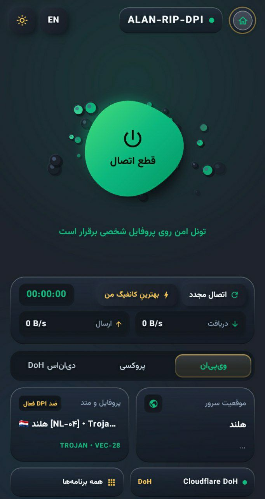
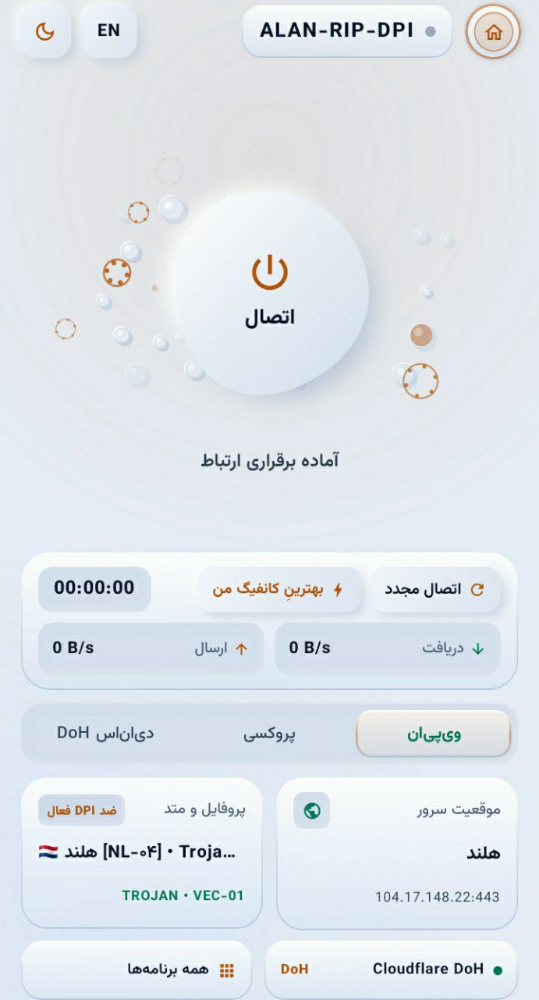

<div align="center">

# Alan-RIP-Dpi — Android

**کلاینت بومی و مهندسی‌شده اندروید جهت دور زدن بازرسی عمیق بسته (DPI)، اسکن هوشمند DoH و مدیریت پیشرفته تونل شبکه**


[**دانلود فایل نصبی APK (Releases)**](../../releases) · [**نسخه ویندوز**](https://github.com/DrAlanK/Alan-RIP-Dpi-Windows) · [**گزارش باگ و پیشنهاد**](../../issues) · [**کانال تلگرام (@LabAlan)**](https://t.me/LabAlan)

<br>

<table>
  <tr>
    <td align="center" width="50%">
      
      <br>
      <sub><b>نمای پوسته تاریک هیبریدی (Liquid Glass + Neumorphism)</b></sub>
    </td>
    <td align="center" width="50%">
      
      <br>
      <sub><b>نمای پوسته روشن هیبریدی (Liquid Glass + Neumorphism)</b></sub>
    </td>
  </tr>
</table>

</div>

---

<div dir="rtl">

## فهرست مطالب

| ردیف | بخش | شرح محتوا |
| :--- | :--- | :--- |
| **۱** | [معرفی اجمالی](#sec-intro) | معماری بومی اندروید، ۲۹ بردار چندریختی ضد DPI، بهینه‌سازی سخت‌افزار و نگهبان حافظه |
| **۲** | [قابلیت‌های کلیدی](#sec-features) | رابط هیبریدی شیشه‌ای-نئومورفیک، حالت پروکسی خالص، مسیریابی و DNS، اسکنر چندهدفه و خروجی لاگ |
| **۳** | [دانلود و نصب سریع](#sec-quickstart) | راهنمای دریافت فایل APK متناسب با پردازنده، امضای رلیز و برقراری اتصال هوشمند |
| **۴** | [ساخت از سورس](#sec-build) | پیش‌نیازهای Android SDK، کامپایل با Gradle و تولید خودکار هر ۴ خروجی APK |
| **۵** | [پرسش‌های رایج و رفع مشکل](#sec-faq) | پنل مخفی سخت‌افزار، پیام Play Protect، بهینه‌سازی باتری و رفع اختلال DNS |
| **۶** | [قدردانی و مشارکت‌کنندگان](#sec-ack) | تقدیر از همکاری‌های فنی و پروژه‌های زیرساختی متن‌باز |
| **۷** | [مجوز انتشار و راه‌های ارتباطی](#sec-license) | قوانین کپی‌رایت، شرایط انتشار MIT، نسخه ویندوز و کانال رسمی تلگرام |

</div>

---

<a id="sec-intro"></a>
<div dir="rtl">

## ۱. معرفی اجمالی

پروژه **Alan-RIP-Dpi Android** نسخه بومی (Native) و بهینه‌شده کلاینت ضد فیلترینگ آلن برای سیستم‌عامل اندروید است که با زبان **Kotlin**، فریم‌ورک **Jetpack Compose**، کتابخانه بومی سطح کرنل (`libalan-oob.so`) و بر پایه هسته قدرتمند **Xray-core v26** توسعه یافته است. هدف اصلی این نرم‌افزار، ارائه یک اتصال پایدار، کم‌مصرف و مقاوم در برابر اختلالات شدید شبکه‌های موبایل (همراه اول، ایرانسل، رایتل، مبین‌نت) و اینترنت‌های خانگی بدون درگیر کردن کاربر با تنظیمات پیچیده فنی است.

نقطه تمایز بنیادین نسخه **`v1.9.0`**، همگام‌سازی کامل با هسته ویندوز در قالب **۲۹ بردار چندریختی ضد DPI (`VEC-00` تا `VEC-28`)**، **موتور مسابقه موازی ۶ مسیره (6-Lane Parallel Engine)** با تستر واقعی دانلود/آپلود، **معماری بهینه‌شده کم‌مصرف** و **نگهبان خودکار ۲۰ دقیقه‌ای ضد نشتی حافظه (`AlanMemoryGuard`)** است؛ به گونه‌ای که تونل در استفاده‌های طولانی‌مدت بدون افت سرعت، بدون داغ شدن دستگاه و بدون کرش پایدار می‌ماند.

**ارکان مهندسی معماری نرم‌افزار:**
1. **موتور ۲۹ بردار چندریختی و پل تمام‌دوطرفه (`FullDuplexMutatorBridge`):** مجهز به ۵ بردار نسل جدید (`VEC-24` تا `VEC-28`) برای عبور از سیاه‌چاله PMTU گیت‌وی‌های استانی (`<=1140B`) و محدودیت قطع جریان ۱۶ کیلوبایتی (`<=880B`)، ترکیب تکنیک‌های `Zero-OOB` و `MSG_OOB` (`libalan-oob.so`)، بافرپول ۳۲ کیلوبایتی بدون فشار GC، تنظیم `TUN MTU=1360` / `TCP_MAXSEG=1220` و انتقال سریع Bulk پس از عبور از پنجره ۶۴ کیلوبایتی DPI.
2. **موتور تصمیم‌گیرنده موازی ۶ مسیره با تستر واقعی پهنای باند:** ارزیابی همزمان ۶ بردار و سرور روی پورت‌های ایزوله با تست پیوسته دانلود (`160KB`) و آپلود (`192KB`) جهت حذف پینگ‌های کاذب، انتخاب لوکیشن از مخزن ابری گیت‌هاب و قفل خودکار سریع‌ترین مسیر.
3. **نگهبان خودکار ضد نشتی حافظه (`AlanMemoryGuard`) و بهینه‌سازی سخت‌افزار:** پایش دوره‌ای هر **۲۰ دقیقه** (قابل تنظیم از ۱۰ تا ۶۰ دقیقه) و واکنش خودکار در شرایط فشار حافظه بدون کرش و بدون قطع VPN (هرس کش DNS، بافرپول، لاگ‌های اضافه و سوکت‌های مرده)، تنظیم هسته Go روی `GOMAXPROCS=2` و `GOGC=150`، توقف کامل رندر انیمیشن UI در پس‌زمینه (`Lifecycle.State.RESUMED`) و Watchdog هوشمند غیرفعال هنگام عبور ترافیک کاربر.
4. **موتور مسیریابی پیشرفته، DNS و اسکنر DoH (`AlanDohEngine / DNSveil`):** اسکن موازی سرورهای `DoH (RFC 8484 / JSON)`، تنظیمات مجزای `Remote / Domestic / Fallback DNS`، حالت‌های مسیریابی (`دور زدن ایران` / `دور زدن LAN` / `سراسری`)، مسدودسازی تبلیغات (`AdBlock`) و `QUIC (UDP 443)` و ورود مستقیم لیست دامنه/آی‌پی بایپس از فایل `.txt`.
5. **رابط کاربری هیبریدی (Liquid Glass + Pure Tactile Neumorphism):** ترکیب کارت‌های شیشه‌ای مات با دکمه اتصال نئومورفیک و حباب‌های سه‌بعدی با سرعت پویا در هر وضعیت، دکمه شیشه‌ای معلق با **جایگاه مگنتی در گوشه بالا** و سایدبار شیشه‌ای قابل جابه‌جایی و تغییر طول، همراه با فونت رسمی **وزیرمتن (`Vazirmatn`)** و دو پوسته تاریک و روشن.

| مشخصه فنی | پیاده‌سازی در Alan-RIP-Dpi Android (v1.9.0) |
| :--- | :--- |
| **تکنولوژی توسعه و رابط کاربری** | Native Kotlin + Jetpack Compose + Hybrid Liquid Glass & Neumorphism (فونت وزیرمتن) |
| **هسته مرکزی و کتابخانه‌های بومی** | Xray-core v26 (`GOMAXPROCS=2`, `GOGC=150`) + `libalan-oob.so` + `libhev-socks5-tunnel.so` |
| **موتور ضد DPI و تستر ترافیک** | ۲۹ بردار چندریختی (`VEC-00` تا `VEC-28`) + موتور ۶ مسیره با تست واقعی دانلود/آپلود |
| **پروتکل‌های پشتیبانی‌شده** | `VLESS`, `VMess`, `Trojan`, `Shadowsocks`, `SOCKS5/4`, `AnyConnect`, `IKEv2`, `L2TP` |
| **مسیریابی، DNS و پایداری** | Routing/DNS کامل + ورود فایل بایپس `.txt` + `AlanDohEngine` + نگهبان ۲۰ دقیقه‌ای حافظه |
| **حالت‌های شبکه** | تونل کامل `VpnService` (با تفکیک برنامه‌ها) + حالت پروکسی خالص (بدون `VpnService`) + `DoH Veil` |

</div>

---

<a id="sec-features"></a>
<div dir="rtl">

## ۲. قابلیت‌های کلیدی

- **سه حالت عملیاتی مستقل (`وی‌پی‌ان` | `پروکسی` | `دی‌ان‌اس DoH`):**
  - **حالت وی‌پی‌ان (`AlanTUN`):** تونل سراسری با `TUN MTU=1360` و **تفکیک دائمی برنامه‌ها (`Per-App Proxy`)** در سه حالت همه برنامه‌ها، فقط انتخابی‌ها (`Include`) و مستثنی‌کردن (`Exclude`).
  - **حالت پروکسی خالص (`Proxy-Only`):** بدون فراخوانی `VpnService` اندروید؛ ترافیک مستقیماً روی پورت‌های محلی `SOCKS5` و `HTTP` نمایش‌داده‌شده در دسترس قرار می‌گیرد.
  - **حالت مستقل `دی‌ان‌اس DoH`:** دور زدن مسمومیت DNS اپراتورها با اسکن و قفل سالم‌ترین سرور DoH.
- **رابط کاربری هیبریدی شیشه‌ای-نئومورفیک و منوی مگنتی:**
  - دکمه اتصال با **حباب‌های سه‌بعدی با سرعت پویا** متناسب با وضعیت (آماده، در حال اتصال، متصل، در حال قطع) و انتقال نرم `در حال قطع اتصال...`.
  - دکمه شیشه‌ای معلق با **جایگاه مگنتی کنار `ALAN-RIP-DPI`**؛ با کشیدن در کل صفحه جابه‌جا می‌شود، با نزدیک شدن به گوشه بالا در جایش قفل می‌شود و در حالت باز، طول (ارتفاع) آن با دستگیره پایینی قابل تغییر است و تا لمس `✕` باز می‌ماند.
- **لیست کانفیگ‌ها به سبک ساده و بهینه `v2rayNG`:**
  - کارت‌های نئومورفیک خلوت و سریع با نوار رنگی انتخاب، تست پینگ فوری با لمس مستقیم عدد پینگ و تفکیک خودکار گروه‌های اشتراک (`Subscription Groups`).
  - پشتیبانی کامل از **اسکن QR با دوربین و گالری**، تولید QR اشتراک‌گذاری، انتخاب چندتایی (`Multi-Select`) و ارسال مستقیم کانفیگ‌های انتخاب‌شده به اسکنر متد.
- **آزمایشگاه موازی متد ضد DPI با انتخاب چند کانفیگ دلخواه:**
  - امکان انتخاب تکی، **انتخاب چند کانفیگ دلخواه از مخزن**، **ورود مستقیم لینک‌های دلخواه به صف اسکنر** یا اسکن کل مخزن.
  - منوی کشویی زیبا (`ModalBottomSheet`) برای انتخاب تکی/چندتایی متدها (۵ متد جدید، بدون OOB یا همه ۲۹ متد) همراه با دکمه اسکن نئومورفیک و وضعیت پویا پس از اتصال/قطع اتصال.
- **تنظیمات کامل مسیریابی (Routing)، DNS و ورود لیست بایپس از فایل:**
  - حالت‌های `دور زدن ایران و LAN`، `فقط LAN` و `سراسری`، انتخاب `DomainStrategy`، مسدودسازی تبلیغات (`AdBlock`)، مسدودسازی `QUIC (UDP 443)` و کنترل `Sniffing`.
  - تنظیم سرورهای `Remote DNS`، `DNS داخلی ایران`، `Fallback DNS`، استراتژی IPv4/IPv6 و **ورود لیست دامنه‌ها و IPهای Direct (بایپس)، Proxy و Block از فایل `.txt`**.
- **پنل مخفی مدیریت سخت‌افزار و نشتی حافظه:**
  - با **۵ بار ضربه روی لوگوی `ALAN-RIP-DPI`** در نوار بالا باز می‌شود و مصرف لحظه‌ای CPU، Java Heap، Total RSS، تعداد File Descriptorهای باز، Threadها، دما/جریان باتری، زمان چک ۲۰ دقیقه‌ای بعدی و دکمه پاکسازی و `GC` فوری را نمایش می‌دهد.
- **کنترل پنل زنده نوتیفیکیشن و کنسول لاگ با خروجی فایل (`.log`):**
  - نمایش لحظه‌ای سرعت دانلود/آپلود و نام کانفیگ در نوتیفیکیشن همراه با دکمه‌های سریع **قطع اتصال**، **اتصال مجدد** و **بهترین سرور**.
  - کنسول لاگ دسته‌بندی‌شده (شبکه، Xray، DNS/حافظه، متد/تست، خطاها) با جستجو و **ذخیره مستقیم کل لاگ‌ها به صورت فایل `.log`**.

</div>

---

<a id="sec-quickstart"></a>
<div dir="rtl">

## ۳. دانلود و نصب سریع

برای نصب و راه‌اندازی سریع برنامه بر روی گوشی یا تبلت اندرویدی خود، مراحل زیر را دنبال کنید:

1. وارد بخش [Releases](../../releases) در همین مخزن شوید و فایل نصبی متناسب با معماری پردازنده دستگاه خود را دانلود نمایید:
   - **`Alan-RIP-Dpi-v1.9.0-arm64-v8a-release.apk`**: مناسب اکثر گوشی‌های جدید و ۶۴ بیتی *(نسخه پیشنهادی و کم‌حجم)*
   - **`Alan-RIP-Dpi-v1.9.0-armeabi-v7a-release.apk`**: مناسب گوشی‌های قدیمی‌تر ۳۲ بیتی
   - **`Alan-RIP-Dpi-v1.9.0-x86_64-release.apk`**: مناسب شبیه‌سازها و تبلت‌های x86_64
   - **`Alan-RIP-Dpi-v1.9.0-universal-release.apk`**: نسخه جامع شامل تمام معماری‌های پردازنده
2. فایل APK دانلودشده را نصب کرده و برنامه **Alan-RIP-Dpi** را اجرا کنید. *(اگر از نسخه‌های `v1.8.0` یا قدیمی‌تر آپدیت می‌کنید، به دلیل مهاجرت به کلید امضای رلیز اختصاصی، یک‌بار نسخه قبلی را حذف و سپس این نسخه را نصب کنید.)*
3. از بخش پایینی صفحه اصلی، می‌توانید حالت عملکرد (`وی‌پی‌ان`، `پروکسی` یا `دی‌ان‌اس DoH`)، کاشی **«موقعیت سرور»** یا کاشی **«پروفایل و متد»** را انتخاب کنید.
4. گوی بزرگ **اتصال** در مرکز صفحه را لمس کنید. در حالت وی‌پی‌ان، مجوز `VpnService` اندروید را تایید نمایید تا تونل ضد DPI فعال شود.

</div>

---

<a id="sec-build"></a>
<div dir="rtl">

## ۴. ساخت از سورس

جهت کامپایل پروژه و تولید فایل‌های اجرایی APK مستقیماً از روی سورس‌کد، رعایت پیش‌نیازهای زیر الزامی است:

- محیط توسعه **Android Studio** (نسخه Ladybug یا جدیدتر) و **Android SDK (API 35)**
- کیت توسعه جاوا **JDK 17** یا **JDK 21** *(توصیه‌شده برای Gradle 8.10.2)*
- ابزار Git

**مراحل کلون کردن مخزن و بیلد از طریق خط فرمان (Gradle Wrapper):**

</div>

```bash
# 1. کلون کردن مخزن رسمی نسخه اندروید
git clone https://github.com/DrAlanK/Alan-RIP-Dpi-Android.git
cd Alan-RIP-Dpi-Android

# 2. ساخت نسخه Debug جهت تست و توسعه (در ویندوز از gradlew.bat استفاده کنید)
./gradlew assembleDebug

# 3. ساخت نسخه نهایی Release (تولید خودکار هر ۴ APK تفکیک‌شده بر اساس معماری)
./gradlew assembleRelease
```

<div dir="rtl">

پس از اتمام موفقیت‌آمیز عملیات کامپایل، فایل‌های نصبی خروجی در مسیر `app/build/outputs/apk/release/` قابل بهره‌برداری خواهند بود.

</div>

---

<a id="sec-faq"></a>
<div dir="rtl">

## ۵. پرسش‌های رایج و رفع مشکل (FAQ)

- **۱. هنگام نصب، پیام «سپر ایمنی Google Play قبلاً برنامه‌ای از این توسعه‌دهنده ندیده است» نمایش داده می‌شود؛ چه کار کنم؟**
  این پیام به معنای وجود ویروس نیست؛ بلکه چون برنامه خارج از گوگل‌پلی و با کلید امضای اختصاصی جدید منتشر شده، گوگل این امضا را در ابتدای انتشار نمی‌شناسد. بدون نیاز به خاموش کردن سپر ایمنی، کافی است در همان پنجره روی گزینه **«درهرحال نصب شود» (Install anyway)** ضربه بزنید.
- **۲. چگونه مصرف واقعی CPU، رم و سلامت حافظه برنامه را بررسی کنیم؟**
  روی نشان **`ALAN-RIP-DPI`** در نوار بالای صفحه **۵ بار پشت سر هم** ضربه بزنید تا **پنل مخفی مدیریت سخت‌افزار و نگهبان حافظه** باز شود. در این پنل می‌توانید مصرف زنده CPU، Java Heap، RSS، Open FDs، تعداد تردها، وضعیت چک ۲۰ دقیقه‌ای و دکمه `پاکسازی و GC فوری` را مشاهده کنید.
- **۳. چرا پس از خاموش شدن صفحه گوشی یا گذشت چند دقیقه، اتصال در پس‌زمینه متوقف می‌شود؟**
  رابط‌های کاربری برخی سازندگان (مانند MIUI/HyperOS شیائومی یا OneUI سامسونگ) سرویس‌های پس‌زمینه را برای ذخیره باتری متوقف می‌کنند. وارد تنظیمات برنامه در گوشی (`App Info > Battery`) شوید و وضعیت مصرف باتری Alan-RIP-Dpi را روی گزینه **بدون محدودیت (Unrestricted)** قرار دهید.
- **۴. چگونه لیست دامنه‌ها یا IPهای بایپس را یکجا از فایل وارد کنیم؟**
  از منوی شیشه‌ای وارد تب **Xray** شوید و به بخش **«مسیریابی (Routing) و بایپس دامنه/IP»** بروید. کنار هر یک از سه لیست (بایپس مستقیم، اجباری از پروکسی، مسدود) دکمه **«ورود از فایل»** قرار دارد که فایل متنی `.txt` شما را خوانده و مستقیم به قوانین مسیریابی اضافه می‌کند.
- **۵. در اینترنت همراه اول یا مبین‌نت اختلال شدید DNS وجود دارد؛ راه‌حل چیست؟**
  از منوی برنامه وارد بخش **«IP/DoH»** شده و در تب اسکنر DoH، دکمه **اسکن DoH** را بزنید تا سریع‌ترین سرور DoH بدون مسمومیت DNS روی اینترنت فعلی شما پیدا و اعمال شود.

</div>

---

<a id="sec-ack"></a>
<div dir="rtl">

## ۶. قدردانی و مشارکت‌کنندگان

توسعه و پایداری **Alan-RIP-Dpi Android** نتیجه پژوهش‌های مستمر فنی و بهره‌گیری از زیرساخت‌های متن‌باز جامعه مهندسی شبکه است. بدین‌وسیله مراتب قدردانی رسمی ثبت می‌گردد:

- **تقدیر ویژه از [Floxu1](https://github.com/Floxu1):** تشکر صمیمانه بابت همفکری‌های مهندسی، راهنمایی‌های فنی ارزشمند و ایده متد ضد فیلترینگ **OOB** که در بهینه‌سازی مکانیزم‌های عبور از DPI این پروژه بسیار راهگشا و الهام‌بخش بوده است.
- **پروژه‌های [Xray-core](https://github.com/XTLS/Xray-core) و [hev-socks5-tunnel](https://github.com/heiher/hev-socks5-tunnel):** به‌عنوان هسته مرکزی پردازش پروتکل‌ها، مسیریابی و لایه TUN بومی اندروید.
- **پروژه‌های [DNSveil](https://github.com/msasanmh/DNSveil)، [ZXing](https://github.com/zxing/zxing) و فونت [وزیرمتن (Vazirmatn)](https://github.com/rastikerdar/vazirmatn):** بابت ایده‌های الهام‌بخش در اسکن DoH، پردازش بارکدهای دوبعدی و تایپوگرافی استاندارد فارسی.

</div>

---

<a id="sec-license"></a>
<div dir="rtl">

## ۷. مجوز انتشار و راه‌های ارتباطی

این نرم‌افزار تحت مجوز استاندارد **MIT License** منتشر شده است. استفاده، مطالعه، تغییر، ادغام و بازنشر کدهای این مخزن با حفظ اعلان کپی‌رایت و مجوز اصلی کاملاً آزاد است. متن کامل حقوقی مجوز در فایل [LICENSE](LICENSE) در ریشه مخزن قابل مشاهده است.

**کانال رسمی اطلاع‌رسانی و نسخه‌های همراه:**
- **کانال تلگرام:** **[@LabAlan](https://t.me/LabAlan)** (`https://t.me/LabAlan`)
- **ریپازیتوری اندروید:** [DrAlanK/Alan-RIP-Dpi-Android](https://github.com/DrAlanK/Alan-RIP-Dpi-Android)
- **ریپازیتوری ویندوز:** [DrAlanK/Alan-RIP-Dpi-Windows](https://github.com/DrAlanK/Alan-RIP-Dpi-Windows) ([دانلود آخرین نسخه ویندوز](https://github.com/DrAlanK/Alan-RIP-Dpi-Windows/releases/latest))

> **سلب مسئولیت فنی:** این پروژه صرفاً با هدف پژوهش در زمینه مهندسی شبکه، بهینه‌سازی پروتکل‌های انتقال داده و حفظ پایداری ارتباطات توسعه یافته است. مسئولیت نحوه بهره‌برداری از این ابزار و رعایت قوانین محلی بر عهده کاربر نهایی است.

</div>

---

<div align="center">

Copyright © 2026 DrAlanK (LabAlan) — Released under the MIT License.

</div>
