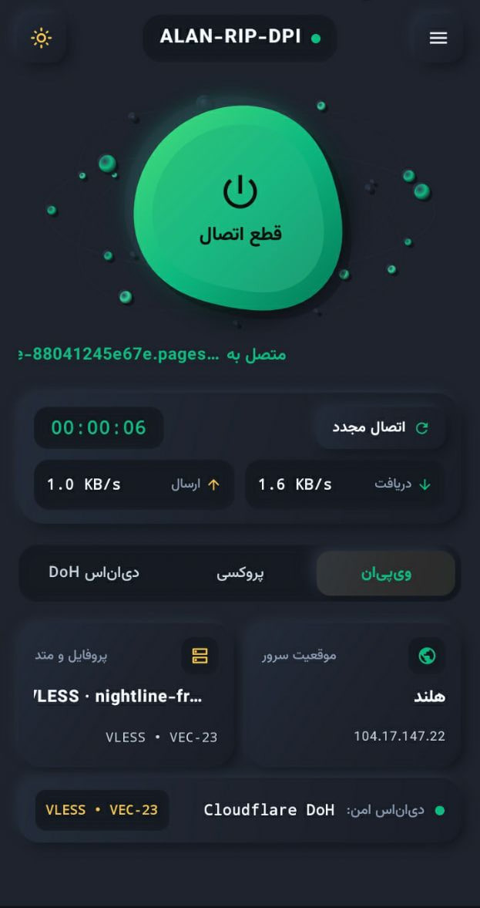
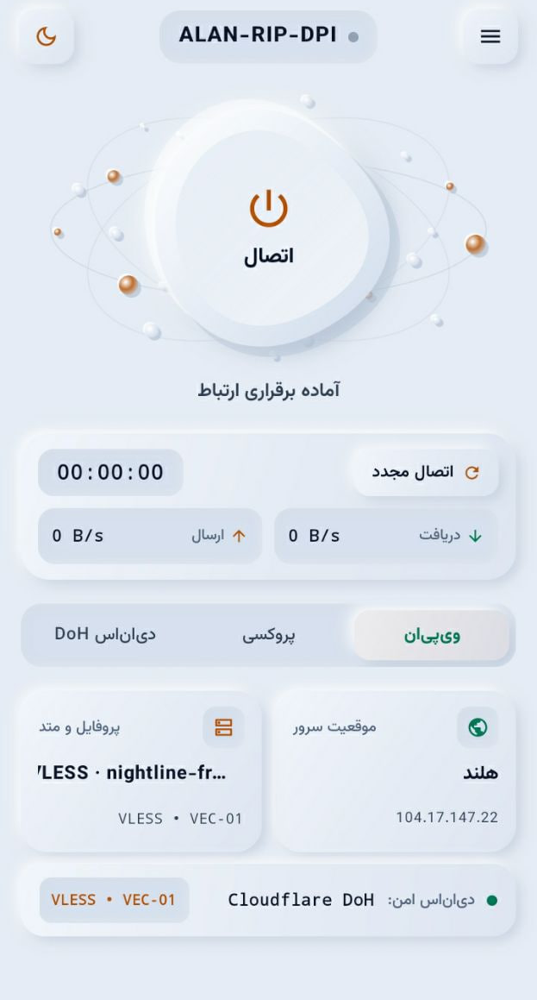

<div align="center">

# Alan-RIP-Dpi — Android

**کلاینت بومی و مهندسی‌شده اندروید جهت دور زدن بازرسی عمیق بسته (DPI) و مدیریت هوشمند تونل شبکه**


[**دانلود فایل نصبی APK (Releases)**](../../releases) · [**گزارش باگ و پیشنهاد**](../../issues) · [**کانال تلگرام (@LabAlan)**](https://t.me/LabAlan)

<br>

<table>
  <tr>
    <td align="center" width="50%">
      
      <br>
      <sub><b>نمای پوسته تاریک (Dark Theme)</b></sub>
    </td>
    <td align="center" width="50%">
      
      <br>
      <sub><b>نمای پوسته روشن (Light Theme)</b></sub>
    </td>
  </tr>
</table>

</div>

---

<div dir="rtl">

## فهرست مطالب

| ردیف | بخش | شرح محتوا |
| :--- | :--- | :--- |
| **۱** | [معرفی اجمالی](#sec-intro) | معماری بومی اندروید، متدولوژی ابداعی ضد DPI و موتور تصمیم‌گیرنده AutoPilot |
| **۲** | [قابلیت‌های کلیدی](#sec-features) | مشخصات فنی، رابط کاربری دوگانه، پروتکل‌ها و سامانه پایش پایداری |
| **۳** | [دانلود و نصب سریع](#sec-quickstart) | راهنمای دریافت فایل APK، مجوزهای اندروید و برقراری اتصال هوشمند |
| **۴** | [ساخت از سورس](#sec-build) | پیش‌نیازهای Android SDK، کامپایل با Gradle و تولید خروجی APK |
| **۵** | [پرسش‌های رایج و رفع مشکل](#sec-faq) | بهینه‌سازی باتری در پس‌زمینه، پایداری روی دیتای موبایل و عیب‌یابی |
| **۶** | [قدردانی و مشارکت‌کنندگان](#sec-ack) | تقدیر از همکاری‌های فنی و پروژه‌های زیرساختی |
| **۷** | [مجوز انتشار و راه‌های ارتباطی](#sec-license) | قوانین کپی‌رایت، شرایط انتشار و کانال رسمی تلگرام |

</div>

---

<a id="sec-intro"></a>
<div dir="rtl">

## ۱. معرفی اجمالی

پروژه **Alan-RIP-Dpi Android** نسخه بومی (Native) و بهینه‌شده کلاینت ضد فیلترینگ آلن برای سیستم‌عامل اندروید است که با زبان **Kotlin** و بر پایه هسته قدرتمند **Xray** توسعه یافته است. هدف اصلی این نرم‌افزار، ارائه یک اتصال پایدار، کم‌مصرف و مقاوم در برابر اختلالات شدید شبکه‌های موبایل (همراه اول، ایرانسل، رایتل) و اینترنت‌های خانگی بدون نیاز به درگیری کاربر با تنظیمات پیچیده فنی است.

نقطه تمایز بنیادین این نرم‌افزار، پیاده‌سازی یک **روش ابداعی و اختصاصی در لایه انتقال و تقطیع بسته‌ها** است؛ به گونه‌ای که برخلاف کلاینت‌های عمومی که در برابر فیلترینگ پویا و مسدودسازی‌های زمان‌مند اپراتورهای تلفن همراه دچار فریز شدن ترافیک (Session Freeze) می‌شوند، این موتور الگوی ارسال بسته‌ها را به‌صورت تطبیقی مدیریت کرده و تونلی پیوسته و بدون افت سرعت ایجاد می‌کند.

**ارکان مهندسی معماری نرم‌افزار:**
1. **متدولوژی ابداعی عبور از DPI:** بهره‌گیری از مکانیزم اختصاصی تطبیق گام‌های ارسال و فرگمنت هوشمند در لایه سوکت هسته Xray جهت عبور بی‌نقص دست‌دهی TLS (TLS Handshake) و پنهان‌سازی SNI از دید تجهیزات بازرسی عمیق بسته در شبکه‌های سلولی و ثابت.
2. **موتور تصمیم‌گیرنده خودکار (AutoPilot Engine):** ارزیابی خودکار مسیر ارتباطی بین نود محلی و سرور مقصد، تست سلامت واقعی تونل و انتخاب بهترین پارامترهای اتصال با یک لمس.
3. **سرویس شبکه سراسری اندروید (Android VpnService):** هدایت یکپارچه تمام ترافیک TCP و UDP اپلیکیشن‌های دستگاه در سطح سیستم‌عامل بدون نیاز به دسترسی روت (Non-Root TUN).
4. **پایشگر زنده وضعیت و ترافیک:** نمایش لحظه‌ای نرخ دانلود و آپلود، وضعیت آماده به کار لایه ضد DPI و مسیر ارتباطی مبدا به مقصد در قالب رابط کاربری مدرن با پشتیبانی از دو پوسته تاریک (طلایی/مشکی) و روشن.

| مشخصه فنی | پیاده‌سازی در Alan-RIP-Dpi Android |
| :--- | :--- |
| **تکنولوژی توسعه و سیستم ساخت** | Native Kotlin + Gradle Kotlin DSL |
| **هسته مرکزی تونل و مسیریابی** | Xray-core (پشتیبانی کامل از TLS / Reality / Native Fragment) |
| **لایه شبکه مجازی سیستم‌عامل** | Android Native `VpnService` (TUN Interface بدون نیاز به Root) |
| **مکانیزم اختصاصی پایداری** | متد ابداعی ضد DPI تطبیقی + پایشگر خودترمیم‌گر اتصال در پس‌زمینه |

</div>

---

<a id="sec-features"></a>
<div dir="rtl">

## ۲. قابلیت‌های کلیدی

* **اتصال هوشمند تک‌لمسی:** راه‌اندازی کامل تونل ضد DPI تنها با لمس دکمه مرکزی اتصال؛ مدیریت خودکار پیکربندی‌ها و انتخاب بهینه‌ترین استراتژی عبور از فیلترینگ متناسب با اپراتور فعلی دستگاه.
* **پایداری ویژه شبکه‌های موبایل (4G/5G):** بهینه‌سازی‌شده برای شرایط تغییر دکل (Handover)، نوسان آنتن‌دهی و تغییر آی‌پی در اینترنت‌های همراه با بهره‌گیری از متد ابداعی حفظ سلامت نشست.
* **رابط کاربری دوگانه و روان (Dark & Light UI):** طراحی بصری مهندسی‌شده و چشم‌نواز دارای دو تم اختصاصی **تاریک** و **روشن** با قابلیت تغییر آنی از نوار ابزار بالایی، نمایشگر گرافیکی وضعیت تونل و نمودار زنده مصرف داده.
* **پشتیبانی کامل از پروتکل‌های مدرن:** سازگاری کامل هسته Xray با پروتکل‌های **VLESS**، **VMess**، **Trojan** و **Shadowsocks** بر بسترهای TCP، WebSocket، gRPC و HTTPUpgrade.
* **مسیریابی هوشمند ترافیک داخلی (Smart Bypass):** امکان عبوردهی مستقیم ترافیک سایت‌ها، پیام‌رسان‌ها و برنامه‌های بانکی داخلی بدون عبور از تونل VPN جهت جلوگیری از اختلال در سرویس‌های بومی و صرفه‌جویی در مصرف ترافیک.
* **مصرف بهینه باتری و منابع پردازشی:** مدیریت دقیق چرخه حیات سرویس پس‌زمینه (Foreground Service) بدون تحمیل بار اضافی به پردازنده گوشی در استفاده‌های طولانی‌مدت.

</div>

---

<a id="sec-quickstart"></a>
<div dir="rtl">

## ۳. دانلود و نصب سریع

برای نصب و راه‌اندازی سریع برنامه بر روی گوشی یا تبلت اندرویدی خود، مراحل زیر را دنبال کنید:

1. وارد بخش [Releases](../../releases) در همین مخزن شوید و آخرین نسخه فایل نصبی (`Alan-RIP-Dpi-v1.0.0.apk`) را دانلود نمایید.
2. فایل APK دانلودشده را اجرا کرده و فرآیند نصب را تکمیل کنید (در صورت نمایش اعلان امنیتی نصب از منابع ناشناس، مجوز نصب را تایید نمایید).
3. برنامه **Alan-RIP-Dpi** را باز کرده، سرور یا پیکربندی مورد نظر خود را انتخاب نمایید.
4. دکمه بزرگ **اتصال** در مرکز صفحه را لمس کنید. در اولین اجرا، سیستم‌عامل اندروید پنجره درخواست ایجاد اتصال شبکه (Connection Request) را نمایش می‌دهد؛ گزینه **OK** را بزنید تا تونل ضد DPI فعال شود.

</div>

---

<a id="sec-build"></a>
<div dir="rtl">

## ۴. ساخت از سورس

جهت کامپایل پروژه و تولید فایل اجرایی APK مستقیماً از روی سورس‌کد، رعایت پیش‌نیازهای زیر الزامی است:

* محیط توسعه **Android Studio** (نسخه Ladybug یا جدیدتر) و **Android SDK**
* کیت توسعه جاوا **JDK 17** یا بالاتر
* ابزار Git

**مراحل کلون کردن مخزن و بیلد از طریق خط فرمان (Gradle Wrapper):**

</div>

```bash
# 1. کلون کردن مخزن رسمی نسخه اندروید
git clone [https://github.com/DrAlanK/Alan-RIP-Dpi-Android.git](https://github.com/DrAlanK/Alan-RIP-Dpi-Android.git)
cd Alan-RIP-Dpi-Android

# 2. ساخت نسخه Debug جهت تست و توسعه (در ویندوز از gradlew.bat استفاده کنید)
./gradlew assembleDebug

# 3. ساخت نسخه نهایی Release
./gradlew assembleRelease
```

<div dir="rtl">

پس از اتمام موفقیت‌آمیز عملیات کامپایل، فایل نصبی خروجی در مسیر `app/build/outputs/apk/` قابل بهره‌برداری خواهد بود.

</div>

---

<a id="sec-faq"></a>
<div dir="rtl">

## ۵. پرسش‌های رایج و رفع مشکل (FAQ)

* **۱. چرا پس از خاموش شدن صفحه گوشی یا گذشت چند دقیقه، اتصال در پس‌زمینه قطع می‌شود؟**
  رابط‌های کاربری برخی سازندگان (مانند MIUI/HyperOS شیائومی یا OneUI سامسونگ) سرویس‌های پس‌زمینه را برای ذخیره باتری متوقف می‌کنند. وارد تنظیمات برنامه در گوشی (`App Info > Battery`) شوید و وضعیت مصرف باتری Alan-RIP-Dpi را روی گزینه **بدون محدودیت (Unrestricted)** قرار دهید.

* **۲. برنامه در حالت «وصل نیست» باقی می‌ماند یا خطای ایجاد رابط VPN می‌دهد؛ علت چیست؟**
  اطمینان حاصل کنید هیچ فیلترشکن دیگری به‌صورت همزمان در حالت «Always-on VPN» در تنظیمات شبکه اندروید قفل نشده باشد، زیرا سیستم‌عامل اندروید در هر لحظه تنها به یک سرویس اجازه در اختیار گرفتن رابط `VpnService` را می‌دهد.

* **۳. هنگام جابه‌جایی بین Wi-Fi و اینترنت موبایل (Mobile Data) چه رفتاری رخ می‌دهد؟**
  لایه مدیریت شبکه برنامه تغییر اینترفیس فیزیکی را تشخیص داده و نشست هسته Xray را بر روی شبکه جدید بازسازی می‌کند. با این حال، در صورت تفاوت شدید الگوی فیلترینگ بین ISP خانگی و اپراتور موبایل، یک بار قطع و وصل مجدد جهت کالیبراسیون لایه ضد DPI توصیه می‌شود.

* **۴. چگونه می‌توان پوسته برنامه را بین حالت شب و روز تغییر داد؟**
  از طریق آیکون خورشید/ماه که در نوار بالایی صفحه اصلی (در کنار نشانگر هسته `Xray`) تعبیه شده است، می‌توانید بدون قطع شدن تونل در لحظه بین پوسته تاریک و روشن جابه‌جا شوید.

</div>

---

<a id="sec-ack"></a>
<div dir="rtl">

## ۶. قدردانی و مشارکت‌کنندگان

توسعه و پایداری **Alan-RIP-Dpi Android** نتیجه پژوهش‌های مستمر فنی و بهره‌گیری از زیرساخت‌های متن‌باز جامعه مهندسی شبکه است. بدین‌وسیله مراتب قدردانی رسمی ثبت می‌گردد:

* **تقدیر ویژه از [Floxu1](https://github.com/Floxu1):** تشکر صمیمانه بابت همفکری‌های مهندسی، راهنمایی‌های فنی ارزشمند و به‌اشتراک‌گذاری متدهای کارآمد عبور از فیلترینگ و DPI که در بهینه‌سازی مکانیزم‌های ارتباطی این پروژه بسیار راهگشا و الهام‌بخش بوده‌اند.
* **پروژه [Xray-core](https://github.com/XTLS/Xray-core):** به‌عنوان هسته مرکزی پردازش پروتکل‌های رمزنگاری، مدیریت فرگمنت و مسیریابی ترافیک.
* **جامعه توسعه‌دهندگان Android & Kotlin:** بابت ابزارها و کتابخانه‌های استاندارد توسعه بومی سیستم‌عامل اندروید.

</div>

---

<a id="sec-license"></a>
<div dir="rtl">

## ۷. مجوز انتشار و راه‌های ارتباطی

این نرم‌افزار تحت مجوز استاندارد **MIT License** منتشر شده است. استفاده، مطالعه، تغییر، ادغام و بازنشر کدهای این مخزن با حفظ اعلان کپی‌رایت و مجوز اصلی کاملاً آزاد است. متن کامل حقوقی مجوز در فایل [LICENSE](LICENSE) در ریشه مخزن قابل مشاهده است.

**کانال رسمی اطلاع‌رسانی و دریافت نسخه‌های جدید:**
جهت دریافت آخرین آپدیت‌های اندروید و ویندوز، نسخه‌های آزمایشی و ارتباط مستقیم با توسعه‌دهنده، به کانال رسمی تلگرام بپیوندید:
* **تلگرام:** [**@LabAlan**](https://t.me/LabAlan) (`https://t.me/LabAlan`)

> **سلب مسئولیت فنی:** این پروژه صرفاً با هدف پژوهش در زمینه مهندسی شبکه، بهینه‌سازی پروتکل‌های انتقال داده و حفظ پایداری ارتباطات توسعه یافته است. مسئولیت نحوه بهره‌برداری از این ابزار و رعایت قوانین محلی بر عهده کاربر نهایی است.

</div>

---

<div align="center">

[](https://t.me/LabAlan)
[](https://github.com/Floxu1)

<br>

<sub>Copyright © 2026 <b>DrAlanK (LabAlan)</b> — Released under the MIT License.</sub>

</div>
